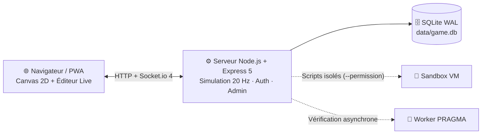
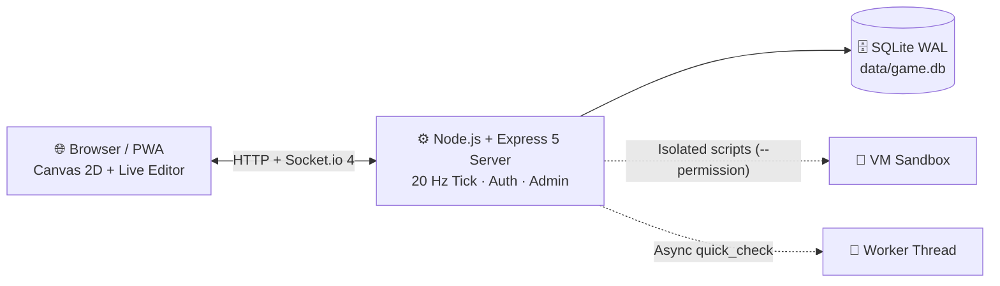

<a id="fr-top"></a>

<div align="center">

  

  # 🌿 Brindiwanko

  **Moteur de MMORPG 2D navigateur avec éditeur de monde temps réel intégré**

  [](package.json)
  [](https://nodejs.org/)
  [](https://www.typescriptlang.org/)
  [](https://socket.io/)
  [](https://github.com/WiseLibs/better-sqlite3)
  [](tests/)
  [](LICENSE)

  <br />

  **🇫🇷 Français** &nbsp;·&nbsp; [🇬🇧 Switch to English](#en-top)

  <br />

  [✨ Fonctionnalités](#fr-fonctionnalites) •
  [🚀 Démarrage](#fr-demarrage) •
  [🕹️ Jouer](#fr-jouer) •
  [🗺️ Éditeur](#fr-editeur) •
  [🛡️ Administration](#fr-administration) •
  [⚙️ Configuration](#fr-configuration) •
  [🌐 Déploiement](#fr-deploiement) •
  [📜 Nouveautés](#fr-changelog)

</div>

---

> 🎮 **Un monde persistant directement dans le navigateur :** dessinez vos cartes, écrivez vos quêtes, placez vos monstres… et vos joueurs voient chaque mise à jour **en direct**, sans recharger la page.

**Brindiwanko** réunit dans **un seul processus Node.js** et **une seule base SQLite** tout le nécessaire pour lancer et administrer un monde en ligne complet : cartes en tuiles, cinématiques, quêtes à étapes, combats temps réel, groupes, guildes, donjons instanciés et raids — sans serveur de base de données externe à configurer.

> [!NOTE]
> **Un projet conçu par IA & validé par l'humain**  
> L'ensemble du code (serveur, client, éditeur, générateurs SVG et tests) est rédigé par intelligence artificielle sous direction technique et créative humaine, puis éprouvé par **330 tests automatisés** (`npm test`), un banc de charge multi-clients et des campagnes de jeu en navigateur. Comme pour tout logiciel, une relecture et des essais en pré-production sont recommandés avant ouverture publique.

---

<a id="fr-fonctionnalites"></a>

## ✨ Panorama des capacités

| Domaine | Fonctionnalités clés |
| :--- | :--- |
| 🗺️ **Éditeur temps réel** | Palettes A–E avec mémoire par onglet, couches automatiques, autotiles, ombres dynamiques, régions, passabilité manuelle, cartes toroïdales, historique des versions, bouton *« Tester la carte »*. |
| 🧩 **Événements & Cinématiques** | Multi-pages conditionnelles, déclencheurs (action, contact, auto, parallèle), éditeur visuel de commandes, fondus, teintes, flashs, secousses, images, météo, caméra, minuteurs. |
| ⚔️ **Combat temps réel** | Affrontements directs sur carte, compétences, altérations d'état, affinités élémentaires, critiques, IA à confinement de région et tables de butin. |
| 📜 **Quêtes & Progression** | Étapes séquentielles, objectifs variés (parler, vaincre, collecter, atteindre une zone), marqueurs `!` / `?`, récompenses et journal de quêtes. |
| 🎒 **Personnage & Économie** | Attributs à répartir, inventaire en grille, équipement, marchands, auberges, coffre de banque, sécurité anti-duplication lors des KO ou changements de carte. |
| 💬 **Social & Guildes** | Canaux All/Carte/Groupe/Guilde/Privé/Système, liste d'amis et d'ignorés, échanges sécurisés, émoticônes, rangs/permissions, banque et journal de guilde, blason généré. |
| 🏰 **Donjons & Raids** | Instances privées par groupe, boss à phases scriptées, verrouillage de présence de groupe à l'entrée, lockouts hebdomadaires et butin aux dés. |
| 👑 **Administration** | Tableau de bord live (CPU, lag, instances), sanctions (`/kick`, `/mute`, `/ban`), outils MJ, journaux d'audit, sauvegardes automatiques et restauration vérifiée. |
| 🎨 **100 % Graphismes générés** | Tilesets, personnages, portraits, monstres, boss, icônes et fenêtres générés en pixel-art vectoriel depuis `assets/generators/` (`npm run assets:build`), libres et sans dépendance tierce. |
| 📱 **Mobile & Bilingue** | Joystick virtuel, boutons `A`/`B`, compétences en arc, bascule tactile/bureau à chaud (`(hover: none)`), PWA plein écran et traduction intégrale **FR / EN**. |

### 🏗️ Architecture technique en bref



<details>
<summary>📁 Arborescence du dépôt</summary>

```text
Brindiwanko/
├── server/       # Serveur Node.js (Express 5, Socket.io, boucle de jeu, dépôts SQLite, migrations)
├── client/       # Client web TypeScript (Canvas 2D, UI RPG modulaire, éditeur visuel intégré)
├── shared/       # Contrats partagés (protocole Socket.io typé, schémas, formules, i18n)
├── assets/       # Générateurs procéduraux SVG de pixel art et ressources compilées
├── views/        # Gabarits EJS des pages web (authentification, personnages, compte, admin)
├── locales/      # Dictionnaires de traduction fr.json et en.json (2 364 clés)
├── scripts/      # Pipeline de build, serveur dev, load-test, export démo, vérifications CI
└── tests/        # Suite de 330 tests automatisés (node --test)
```

</details>

---

<a id="fr-demarrage"></a>

## 🚀 Installation & Lancement en local (PC / Mac / Linux)

Envie de tester ou de créer votre jeu directement sur votre ordinateur ? Suivez ces deux étapes simples :

### 1. Installer Node.js (et Git)

Brindiwanko nécessite **Node.js 26 LTS** *(recommandé)* ou **Node.js 24 minimum**.

| Système | Où télécharger et installer Node.js |
| :--- | :--- |
| 🪟 **Windows** | Téléchargez l'installeur **`.msi` (LTS)** sur **[nodejs.org/fr/download](https://nodejs.org/fr/download)** *(ou via PowerShell : `winget install OpenJS.NodeJS.LTS`)*, puis ouvrez un nouveau terminal. Pour cloner avec Git, installez aussi **[git-scm.com](https://git-scm.com/downloads/win)** *(ou téléchargez simplement le ZIP depuis GitHub)*. |
| 🍎 **macOS** | Téléchargez l'installeur **`.pkg` (LTS)** sur **[nodejs.org/fr/download](https://nodejs.org/fr/download)** *(ou via Homebrew : `brew install node git`)*. |
| 🐧 **Linux (Ubuntu / Debian / etc.)** | Utilisez le sélecteur officiel sur **[nodejs.org/fr/download](https://nodejs.org/fr/download)** ou **`nvm`** *(voir [la procédure VPS Linux](#fr-nvm))* *(évitez `sudo apt install nodejs` seul, qui installe souvent une version trop ancienne)* et vérifiez que `git` est installé (`sudo apt install -y git`). |

Vérifiez dans votre terminal que Node.js est bien reconnu *(doit afficher `v24...` ou `v26...`)* :

```bash
node -v
npm -v
```

### 2. Télécharger, compiler et démarrer le jeu en local

Ouvrez un terminal (PowerShell, Terminal macOS ou Linux) et tapez simplement :

```bash
# 1. Télécharger le projet (ou décompressez le ZIP puis placez-vous dans le dossier)
git clone https://github.com/brindiwankorpg/Brindiwanko.git
cd Brindiwanko

# 2. Installer les dépendances
npm install

# 3. Générer les ressources graphiques et compiler le jeu (à faire au moins une fois)
npm run build

# 4. Lancer le serveur local
npm start
```

> [!NOTE]
> Le fichier `.npmrc` bloque l'exécution de scripts d'installation tiers : `better-sqlite3` et `bcrypt` utilisent leurs binaires précompilés (Windows, Linux, macOS). Aucun compilateur C++ n'est nécessaire.

🌐 Ouvrez ensuite **<http://localhost:3000>** dans votre navigateur !  
Au tout premier lancement, le terminal vous demande la langue du monde de démonstration (`EN` ou `FR`), crée la base `data/game.db` et génère le village de départ.

- **Pour développer / modifier le code :** utilisez `npm run dev` à la place de `npm start` pour recompiler et relancer automatiquement à chaque modification.
- **Pour arrêter le serveur local :** appuyez sur <kbd>Ctrl</kbd>+<kbd>C</kbd> dans le terminal *(pour le relancer plus tard, un simple `npm start` suffit sans refaire `npm install`)*.

### 👑 Premier compte administrateur

Le **tout premier utilisateur** inscrit reçoit automatiquement le rôle d'**administrateur**. Les comptes suivants démarrent en joueurs standards ; les promotions/rétrogradations depuis `/admin` s'appliquent instantanément, y compris en cours de partie.

> [!IMPORTANT]
> **Protection en production (`NODE_ENV=production`) :** tant que la base ne contient aucun compte, l'inscription initiale exige un **code d'installation** (`SETUP_CODE`) lu depuis la variable d'environnement ou affiché une fois dans le journal de démarrage.

---

<a id="fr-jouer"></a>

## 🕹️ Commandes & Guide du Joueur

<details open>
<summary>🎮 Raccourcis clavier, mobile et fenêtres d'interface</summary>

| Action | Clavier / Souris | Mobile / Tactile |
| :--- | :--- | :--- |
| **Se déplacer** | <kbd>↑</kbd> <kbd>↓</kbd> <kbd>←</kbd> <kbd>→</kbd>, <kbd>Z</kbd><kbd>Q</kbd><kbd>S</kbd><kbd>D</kbd>, <kbd>W</kbd><kbd>A</kbd><kbd>S</kbd><kbd>D</kbd> ou clic gauche | Joystick virtuel |
| **Interagir / Attaque frontale** | <kbd>Espace</kbd> ou <kbd>Entrée</kbd> | Bouton <kbd>A</kbd> |
| **Attaquer** | <kbd>F</kbd> | Bouton d'attaque |
| **Barre d'actions (1–8)** | <kbd>1</kbd> à <kbd>8</kbd> | Compétences en arc |
| **Menu principal / Annuler** | <kbd>Échap</kbd> | Bouton <kbd>B</kbd> / Menu |

| Fenêtre | Touche | Fenêtre | Touche |
| :--- | :---: | :--- | :---: |
| 🎒 **Sac (Inventaire)** | <kbd>I</kbd> | 📜 **Journal de quêtes** | <kbd>J</kbd> |
| 👤 **Fiche Personnage** | <kbd>C</kbd> | 👥 **Amis & Ignorés** | <kbd>L</kbd> |
| 🔮 **Compétences** | <kbd>K</kbd> | 🛡️ **Guilde** | <kbd>G</kbd> |
| ⚔️ **Groupe** | <kbd>P</kbd> | 🗺️ **Carte du monde** | <kbd>M</kbd> |
| ⚙️ **Options** | <kbd>O</kbd> | 💬 **Tchat** | <kbd>Entrée</kbd> |

</details>

- **Premiers pas :** un seul personnage actif par compte à la fois ; gestion du mot de passe, de l'e-mail et suppression définitive depuis **Mon compte** ; récupération d'accès via **Mot de passe oublié ?** *(lien valide 1 h, requiert `SMTP_URL`)*.
- **Ciblage & Social :** glisser-déposer vers la barre 1–8, clic sur un joueur ou un pseudo pour chuchoter, échanger, inviter, inspecter, ignorer ou signaler *(anti-spam 10 s entre invitations, 1 min après refus)*.
- **Partage XP, Butin & Raids :** XP et or répartis au prorata des dégâts *(+10 % par allié de groupe présent)* ; le butin revient au plus gros contributeur ; un boss de raid reste invulnérable tant que tout le groupe n'a pas franchi l'entrée.
- **Sécurité économique :** boutiques, auberges et coffres se ferment automatiquement en cas de KO ou de changement de carte.

---

<a id="fr-editeur"></a>

## 🗺️ Prise en main de l'éditeur de monde

Accessible aux administrateurs depuis le jeu via **Administration** 👑 ➔ **« Ouvrir l'éditeur de cartes »**. Les sauvegardes mettent à jour le monde connecté **en temps réel**.

| Module | Rôle principal |
| :--- | :--- |
| **Cartes & Passabilité** | Arborescence, calques auto/tuiles, ombres, régions, boucle toroïdale, verrou d'édition multi-admin et surcharge de passabilité par case. |
| **Propriétés & Spawns** | Dimensions, tileset, PvP, instanciation de donjon, musiques BGM/BGS, zones et effectifs d'apparition des monstres. |
| **Événements & Base de données** | Événements rapides (PNJ, coffres, téléporteurs), pages/conditions, classes, sorts, objets, monstres, quêtes, raids, import/export JSON sans perte. |

- ▶️ **« Tester la carte » :** sauvegarde, ferme l'éditeur et téléporte votre personnage directement sur la case visée.
- 🖼️ **Ressources & Imports :** détection de type et dimensions, protection contre les fichiers tronqués, mise en **quarantaine** automatique de tout script importé tant qu'un administrateur ne l'a pas validé dans *« Scripts à vérifier »*.
- 🗑️ **Sécurité d'édition :** avertissement listant les dépendances avant suppression ; les identifiants supprimés (comptes, personnages, cartes, fiches) ne sont jamais réattribués.
- 🪜 **Cases spéciales & Interrupteurs :** une tuile **échelle** oriente vers le haut ; un **sol à dégâts** retire 10 PV par pas sans tuer ; les interrupteurs **d'instance** (onglet Système) isolent l'état d'une session de donjon.

---

<a id="fr-administration"></a>

## 🛡️ Administration & Modération

### 📊 Console `/admin`
- **Tableau de bord live :** charge CPU échantillonnée périodiquement, latence de boucle d'événements, joueurs en ligne et instances actives.
- **Comptes & Outils MJ :** rôles, avertissements, sourdine, bannissements, réinitialisation de mot de passe *(modérateurs sans accès IP et e-mails masqués ; le propriétaire initial ne peut être rétrogradé)*, téléportation, invisibilité, dons, interrupteurs/variables et annonces.
- **Audit & Sauvegardes :** journaux de connexions, échanges, ventes, butins rares et modération ; export `.db` nettoyé des sessions/secrets ; restauration avec double contrôle de schéma SQLite et redemande de mot de passe administrateur.

### 💬 Commandes de modération en jeu

| Commande | Rôle minimal | Action |
| :--- | :---: | :--- |
| `/kick <joueur> [motif]` | Modérateur | Expulse immédiatement la session. |
| `/mute <joueur> [durée] [motif]` | Modérateur | Coupe le chat (`30m`, `2h`, `7j`). |
| `/unmute <joueur>` | Modérateur | Lève la mise en sourdine. |
| `/ban <joueur> [durée\|perm] [motif]` | Administrateur | Suspend le compte temporairement ou définitivement. |
| `/unban <joueur>` | Administrateur | Révoque un bannissement actif. |
| `/all <message>` | Modérateur | Annonce sur le canal global staff. |
| `/pkick <joueur>` | Joueur (Chef) | Retire un membre du groupe. |

> [!TIP]
> **Rétention & Confidentialité :** sauvegardes nocturnes automatiques (par défaut 4 h, conservation 1 / 7 / 14 / 31 jours), purge quotidienne des journaux de plus de 90 jours, et effacement irréversible des IP lors de la suppression d'un compte.

---

## 🌳 Monde de démonstration

Une base neuve démarre avec un monde jouable complet : **Village de Brindiwanko**, **Forêt de Bruyère**, **Intérieurs**, **Grotte de Bruyère** *(donjon instancié avec le Roi Gobelin)* et **Chapitre 1**.

```bash
# Exporter le monde de démonstration vers demo/
npm run demo:export
```

> **Réinitialiser le monde :** arrêtez le serveur, supprimez `data/game.db*` (`-wal` et `-shm` inclus), puis relancez. Sans terminal interactif (pm2, Docker), définissez `CONTENT_LANGUAGE=fr` ou `en`.

---

<a id="fr-configuration"></a>

## ⚙️ Configuration

Toutes les variables d'environnement sont optionnelles :

| Variable | Défaut | Rôle |
| :--- | :---: | :--- |
| `PORT` / `HOST` | `3000` / `0.0.0.0` | Port et adresse d'écoute (`127.0.0.1` conseillé derrière nginx). |
| `DB_PATH` | `data/game.db` | Chemin absolu ou relatif au projet de la base SQLite (backups à côté). |
| `DATA_DIR` / `UPLOADS_DIR` | `data/` / `uploads/` | Dossiers des données par défaut et des ressources importées. |
| `NODE_ENV` | — | `production` active cookies `Secure`, HSTS et caches statiques. |
| `SESSION_SECRET` | auto-généré | Secret de signature des sessions HTTP. |
| `TRUST_PROXY` | `false` | Accepter `1` ou `true` derrière un reverse proxy (`0`/`false` pour désactiver ; échoue au démarrage sinon). |
| `PUBLIC_URL` | — | Origine publique (ex. `https://mondomaine.fr`) requise contre les attaques CSWSH. |
| `SETUP_CODE` | aléatoire | Code du premier compte administrateur en production (à fixer explicitement si vos logs sont centralisés). |
| `CONTENT_LANGUAGE` | prompt terminal | `fr` ou `en` pour générer le monde de démonstration sans saisie interactive. |
| `REGISTRATIONS_PER_HOUR` | `10` *(prod)* | Limite d'inscriptions par heure et par IP (`0` = illimité). |
| `IMPORTS_PER_15_MIN` | `3` *(prod)* | Limite d'imports de projet (200 Mo max) par compte / 15 min (`0` = illimité). |
| `MAX_CHARACTERS` | `4` | Nombre maximum de personnages par compte. |
| `SMTP_URL` / `MAIL_FROM` | — | Relais SMTP sortant et expéditeur pour la réinitialisation de mot de passe. |

---

## 🧪 Tests & Assurance Qualité

```bash
# Contrôles lexicaux, parité i18n (clés + {{placeholders}} + vues .ejs) et 330 tests
npm test

# Vérification TypeScript stricte (serveur, client, outils)
npm run typecheck

# Test de charge : 80 clients simultanés pendant 15 secondes
npm run load-test -- 80 15
```

> [!NOTE]
> Tous les tests s'exécutent dans un répertoire temporaire isolé : `data/` et `uploads/` restent intacts.

---

<a id="fr-deploiement"></a>

## 🌐 Mettre son jeu en ligne sur un VPS (Guide pas à pas)

> [!NOTE]
> **Configuration VPS recommandée :** un **VPS Linux** (**Debian / Ubuntu** recommandé) avec **4 Go de RAM** et **au moins 2 vCore**, ainsi qu'un nom de domaine *(ex. `mondomaine.fr`)*.

Pas besoin d'être administrateur système pour héberger Brindiwanko. Voici l'idée générale en deux phrases :

- Ton jeu tourne **en privé à l'intérieur du VPS** (sur `127.0.0.1:3000`, fermé à Internet).
- **Nginx** sert de porte d'entrée publique : il accueille les joueurs sur `https://mondomaine.fr`, gère le **cadenas HTTPS** gratuit (via Certbot) et transmet tout au jeu en coulisses.

| Ce que tapent les joueurs | Porte d'entrée publique | Où tourne réellement le jeu |
| :--- | :--- | :--- |
| `https://mondomaine.fr` | **Nginx** (ports `80` / `443` + cadenas SSL) | **Node.js** en local (`127.0.0.1:3000`) |

---

<a id="fr-nvm"></a>

### 🐧 Installer Node.js et `npm` via `nvm`

Sur Ubuntu ou Debian, les dépôts `apt` par défaut proposent souvent une version de Node.js inférieure à `24`. **`nvm`** (Node Version Manager) permet d'installer **Node.js 26 LTS** et **`npm`** directement dans ton dossier utilisateur, sans privilèges `root` :

```bash
# Télécharger et installer nvm :
curl -o- https://raw.githubusercontent.com/nvm-sh/nvm/v0.41.0/install.sh | bash

# Charger nvm sans redémarrer le terminal :
\. "$HOME/.nvm/nvm.sh"

# Télécharger et installer Node.js :
nvm install 26

# Vérifier les versions de Node.js et npm :
node -v # Ex. "v26.x.x" (ou >= v24)
npm -v  # Ex. "11.x.x"
```

> [!NOTE]
> **Utilisateurs avancés :** si tu maîtrises Linux et préfères une installation système de Node.js (`>= 24`) via `apt` *(par exemple avec les dépôts NodeSource)*, c'est tout à fait possible. Ce guide reste toutefois volontairement axé sur **`nvm`**, car c'est la méthode la plus simple pour obtenir immédiatement la bonne version sur un VPS sans modifier les paquets système.

---

### Étape 1 — Faire pointer ton nom de domaine vers l'IP du VPS

Avant d'installer quoi que ce soit, il faut dire à Internet que `mondomaine.fr` correspond à ton serveur (VPS) :

1. Connecte-toi chez le fournisseur où tu as acheté ton nom de domaine (OVH, Namecheap, Gandi, Cloudflare…) et ouvre la rubrique **Zone DNS**.
2. Crée un enregistrement de type **`A`** :
   - **Nom / Hôte :** `@` *(ou laisse vide selon le site — cela correspond au domaine principal `mondomaine.fr`)*
   - **Cible / IPv4 :** **l'adresse IP publique de ton VPS** *(là où le jeu va se lancer)*
3. *(Optionnel, pour que `www.mondomaine.fr` fonctionne aussi)* Ajoute un second enregistrement **`A`** avec **Nom :** `www` et la **même adresse IP du VPS**.
4. Attends quelques minutes que la modification soit prise en compte, puis connecte-toi en SSH sur ton VPS (Ubuntu ou Debian) pour vérifier et ouvrir les ports web du pare-feu :

```bash
# Doit afficher exactement l'adresse IP publique de ton VPS :
dig +short mondomaine.fr

# Si tu utilises le pare-feu UFW sur ton VPS, autorise le trafic web (ports 80 et 443) :
sudo ufw allow 'Nginx Full'
sudo ufw status
```

---

### Étape 2 — Télécharger, compiler et lancer Brindiwanko sur le VPS (`git clone` + `pm2`)

Si tu lances le jeu avec un simple `npm start`, **il s'arrêtera dès que tu fermeras la fenêtre SSH**. On clone donc le projet sur le VPS, on le compile, puis on utilise **`pm2`** pour le garder allumé 24h/24 et le relancer automatiquement si le VPS redémarre.

**1. Télécharger le projet sur le VPS (`git clone`) :**

```bash
sudo apt update && sudo apt install -y git
git clone https://github.com/brindiwankorpg/Brindiwanko.git
cd Brindiwanko
```

**2. Installer `pm2` :**

```bash
npm install -g pm2
```

> [!NOTE]
> **Pourquoi sans `sudo` ?** Avec **`nvm`** *(la méthode suivie dans ce guide)*, Node.js et `npm` sont installés dans ton dossier utilisateur (`~/.nvm`) : **n'utilise surtout pas `sudo`**, sinon Linux renverra `sudo: npm: command not found`.
>
> En revanche, si tu as installé Node.js `>= 24` au niveau système via **`apt`**, lance `sudo npm install -g pm2`.

**3. Compiler et démarrer le jeu en arrière-plan** *(remplace `mondomaine.fr` par ton vrai domaine)* :

```bash
# Installer les paquets et compiler le jeu pour la production
npm install && npm run build

# Démarrer le jeu en arrière-plan
NODE_ENV=production HOST=127.0.0.1 TRUST_PROXY=1 CONTENT_LANGUAGE=fr PUBLIC_URL=https://mondomaine.fr PORT=3000 pm2 start dist/server/index.js --name Brindiwanko

# Enregistrer le démarrage automatique au reboot du VPS
# (copie et exécute la commande sudo affichée par pm2 startup, puis lance pm2 save)
pm2 startup
pm2 save
```

> [!IMPORTANT]
> **À retenir :**
> - `HOST=127.0.0.1` garantit que personne ne peut contourner Nginx en tapant `http://IP_DU_VPS:3000`.
> - N'utilise **jamais** l'option cluster (`-i`) de `pm2` : le monde du jeu doit vivre dans un seul processus.
> - Évite de lancer le jeu en `root` si possible (crée un utilisateur Linux standard pour ton serveur).

---

### Étape 3 — Installer Nginx (la porte d'entrée)

1. Installe Nginx et ouvre un nouveau fichier de configuration pour ton domaine *(remplace `mondomaine.fr` partout par ton vrai domaine)* :

```bash
sudo apt update && sudo apt install nginx -y
sudo nano /etc/nginx/sites-available/mondomaine.fr
```

2. Colle exactement ce texte dans l'éditeur *(si tu n'as pas créé le sous-domaine `www` à l'étape 1, enlève simplement `www.mondomaine.fr` sur la ligne `server_name`)* :

```nginx
server {
    listen 80;
    listen [::]:80;
    server_name mondomaine.fr www.mondomaine.fr;

    client_max_body_size 500m;

    location / {
        proxy_pass http://127.0.0.1:3000;
        proxy_http_version 1.1;
        proxy_set_header Upgrade $http_upgrade;
        proxy_set_header Connection "upgrade";
        proxy_set_header Host $host;
        proxy_set_header X-Real-IP $remote_addr;
        proxy_set_header X-Forwarded-Host $host;
        proxy_set_header X-Forwarded-For $proxy_add_x_forwarded_for;
        proxy_set_header X-Forwarded-Proto $scheme;
    }
}
```

> 💡 **Pour enregistrer et quitter `nano` :** appuie sur <kbd>Ctrl</kbd>+<kbd>O</kbd>, puis <kbd>Entrée</kbd>, puis <kbd>Ctrl</kbd>+<kbd>X</kbd>.

3. Active ce fichier, teste que tout est bien écrit, puis recharge Nginx :

```bash
sudo ln -s /etc/nginx/sites-available/mondomaine.fr /etc/nginx/sites-enabled/
sudo nginx -t
sudo systemctl reload nginx
```

> ✅ **Contrôle :** `sudo nginx -t` doit afficher `syntax is ok` et `test is successful`.

---

### Étape 4 — Ajouter le cadenas HTTPS gratuitement (`Certbot`)

Certbot va demander un certificat SSL gratuit à Let's Encrypt et modifier le fichier Nginx tout seul pour activer `https://` *(enlève `-d www.mondomaine.fr` si tu n'as pas configuré `www`)* :

```bash
sudo apt install certbot python3-certbot-nginx -y
sudo certbot --nginx --cert-name mondomaine.fr -d mondomaine.fr -d www.mondomaine.fr
```

Pendant l'installation, réponds aux questions à l'écran :
1. Entre ton **adresse e-mail** *(pour les alertes d'expiration)*.
2. Accepte les conditions (`Y`) et valide la redirection automatique vers HTTPS.
3. Vérifie que le renouvellement automatique fonctionne bien :

```bash
sudo certbot renew --dry-run
```

---

### Étape 5 — Créer ton premier compte Administrateur 🎉

1. Ouvre **`https://mondomaine.fr`** dans ton navigateur : le cadenas vert/sécurisé doit être présent et le jeu s'affiche !
2. Clique sur **Créer un compte** *(le tout premier compte créé obtient automatiquement les droits d'administrateur)*.
3. En production, un **code d'installation** est demandé la première fois : récupère-le dans les journaux du serveur avec :

```bash
pm2 logs Brindiwanko --lines 30
```

*(Tu peux aussi fixer ton propre code au lancement à l'étape 2 en ajoutant `SETUP_CODE=mon-code-secret` devant la commande `pm2 start`).*

<details>
<summary>🩺 En cas de problème (blocages courants & solutions)</summary>

| Ce que tu vois | Ce qui se passe | Comment régler ça |
| :--- | :--- | :--- |
| `sudo: npm: command not found` lors de l'installation de `pm2` | Node.js et `npm` ont été installés via `nvm` (dans `~/.nvm`, inaccessible à `sudo`). | Lance `npm install -g pm2` **sans `sudo`** *(réserve `sudo` aux installations système via `apt`)*. |
| Page **`502 Bad Gateway`** | Nginx fonctionne, mais le jeu est arrêté ou plante au démarrage. | Lance `pm2 status` et `pm2 logs Brindiwanko` pour voir l'erreur, puis `pm2 restart Brindiwanko`. |
| `dig +short mondomaine.fr` n'affiche pas l'IP du VPS | Le DNS n'est pas encore configuré ou pas encore propagé. | Vérifie ton enregistrement `A` chez ton registrar et patiente 5–15 min avant de lancer Certbot. |
| `nginx -t` dit `No such file` | Un lien symbolique dans `/etc/nginx/sites-enabled/` pointe vers un fichier supprimé. | Supprime le lien cassé (`sudo rm /etc/nginx/sites-enabled/<nom>`) et refais `sudo ln -s ...`. |
| `bind() to 0.0.0.0:80 failed` | Un autre serveur web (souvent **Apache2**) est déjà allumé sur le port `80`. | Trouve-le avec `sudo ss -tulpn \| grep :80` puis arrête Apache : `sudo systemctl stop apache2 && sudo systemctl disable apache2`. |
| Certbot échoue sur `www` | Tu n'as pas mis d'enregistrement DNS pour `www.mondomaine.fr`. | Relance sans `www` : `sudo certbot --nginx --cert-name mondomaine.fr -d mondomaine.fr`. |
| **`WebSocket ... code: 400`** dans le navigateur | Soit les en-têtes `Upgrade`/`Connection` manquent dans le bloc Nginx actif (port `443`), soit `PUBLIC_URL` ne correspond pas exactement à l'URL ouverte (`www` vs sans `www`, `http` vs `https`). | Vérifie `pm2 logs Brindiwanko` (affiche le détail du rejet) et `sudo nginx -T`, puis assure-toi que `Upgrade` + `Connection "upgrade"` sont présents sur le port `443` et que `PUBLIC_URL` correspond exactement à l'adresse du navigateur. |

</details>

<details>
<summary>☁️ Derrière Cloudflare ou un proxy amont (module realip nginx)</summary>

Avec un proxy devant nginx, `TRUST_PROXY=1` seul ferait voir à l'application l'IP du proxy (partage des quotas d'inscription et de connexion). Ajoutez dans le bloc `server { ... }` :

```nginx
# Plages officielles Cloudflare (https://www.cloudflare.com/ips/)
set_real_ip_from 173.245.48.0/20;
set_real_ip_from 103.21.244.0/22;
set_real_ip_from 103.22.200.0/22;
set_real_ip_from 103.31.4.0/22;
set_real_ip_from 141.101.64.0/18;
set_real_ip_from 108.162.192.0/18;
set_real_ip_from 190.93.240.0/20;
set_real_ip_from 188.114.96.0/20;
set_real_ip_from 197.234.240.0/22;
set_real_ip_from 198.41.128.0/17;
set_real_ip_from 162.158.0.0/15;
set_real_ip_from 104.16.0.0/13;
set_real_ip_from 104.24.0.0/14;
set_real_ip_from 172.64.0.0/13;
set_real_ip_from 131.0.72.0/22;
set_real_ip_from 2400:cb00::/32;
set_real_ip_from 2606:4700::/32;
set_real_ip_from 2803:f800::/32;
set_real_ip_from 2405:b500::/32;
set_real_ip_from 2405:8100::/32;
set_real_ip_from 2a06:98c0::/29;
set_real_ip_from 2c0f:f248::/32;

real_ip_header CF-Connecting-IP;
```

Pour un autre proxy, remplacez les plages par ses IP et utilisez `real_ip_header X-Forwarded-For;` avec `real_ip_recursive on;`. Conservez `TRUST_PROXY=1`.

</details>

<details>
<summary>💾 Restauration et procédure de mise à jour</summary>

```bash
# Lister ou préparer la restauration d'une sauvegarde (puis redémarrer)
npm run restore
npm run restore -- latest
pm2 restart Brindiwanko
```

```bash
# Mise à jour sécurisée
npm run restore           # Vérifier la présence d'une sauvegarde récente
git pull
npm install && npm run build
pm2 restart Brindiwanko
```

> Les migrations SQLite s'appliquent automatiquement au démarrage. La base remplacée reste conservée avec le suffixe `.before-restore`, et les sauvegardes appliquées sont purgées de toute session ou secret.

</details>

---

<a id="fr-changelog"></a>

## 📜 Journal des modifications (Derniers correctifs)

Historique détaillé dans [CHANGELOG.md](CHANGELOG.md). Principaux apports depuis `1.0.0-beta.1` :

- 🔒 **Sécurité & restauration à chaud :** vérification du mot de passe et du verrou `restoring` avant le buffering sur `POST /api/admin/restore`, `prepareRestore` asynchrone (Worker + `fs.promises.cp`), contrôle anti-chevauchement ZIP, durcissement SVG/sandbox/Socket.io (`Sec-Fetch-Site`) et libération des verrous d'édition au changement de mot de passe.
- ⚡ **Performance, fiabilité & cycle de vie :** migration `002_indexes.sql` (6 index secondaires), cache `SettingsRepository`, requêtes unifiées sur l'annuaire des guildes, parsing JSON défensif, suppression atomique de compte par transaction SQLite, contrôle multi-onglets (`characterId`), nettoyage `AbortController`/`destroy()` côté client et validation `i18n:check` étendue.
- 🗺️ **Combat & IA des régions :** confinement des monstres dans leur région en `idle` et fuite sur zone peinte, détection d'aggro à 1 case des bordures et retour maison au-delà de 2 cases hors zone *(boss à 1 case non bridés)*.
- 🎮 **Ergonomie joueur & éditeur :** focus clavier rendu au clic carte, buffer d'action de `150 ms`, masquage des barres/chat pendant les dialogues actifs, bascule tactile dynamique sans `F5`, mémoire par onglet de la palette et boutons `+ Ajouter` ancrés.

---

<div align="center">

📄 Sous licence **[Apache 2.0](LICENSE)** &nbsp;·&nbsp; [⬆️ Haut de page (FR)](#fr-top) &nbsp;·&nbsp; [🇬🇧 English README](#en-top)

</div>

---

<br />

<a id="en-top"></a>
<a id="english"></a>

<div align="center">

  

  # 🌿 Brindiwanko (English)

  **A browser-based 2D MMORPG engine with a built-in live world editor**

  [](package.json)
  [](https://nodejs.org/)
  [](https://www.typescriptlang.org/)
  [](https://socket.io/)
  [](https://github.com/WiseLibs/better-sqlite3)
  [](tests/)
  [](LICENSE)

  <br />

  [🇫🇷 Lire en Français](#fr-top) &nbsp;·&nbsp; **🇬🇧 English**

  <br />

  [✨ Highlights](#en-highlights) •
  [🚀 Quick Start](#en-quick-start) •
  [🕹️ Playing](#en-playing) •
  [🗺️ Editor](#en-editor) •
  [🛡️ Administration](#en-administration) •
  [⚙️ Configuration](#en-configuration) •
  [🌐 Deployment](#en-deployment) •
  [📜 Changelog](#en-changelog)

</div>

---

> 🎮 **A living world in your browser:** design your maps, script your quests, place monsters… and players see changes go **live**, with zero page reloads.

**Brindiwanko** packs everything needed to run a persistent online RPG inside **a single Node.js process** backed by **a single SQLite database**: tilemaps, scripted cutscenes, multi-step quests, real-time combat, parties, guilds, instanced dungeons, and raids — with no external database server to maintain.

> [!NOTE]
> **An AI-Engineered & Human-Validated Project**  
> All source code (server, client, editor, SVG generators, and test suites) was authored by AI under human creative and technical direction, and validated by **330 automated tests** (`npm test`), a multi-client stress tester, and browser verification sessions. Review and stage-test before production rollouts; bug reports and PRs are always welcome.

---

<a id="en-highlights"></a>

## ✨ Highlights

| Area | Capabilities |
| :--- | :--- |
| 🗺️ **Live World Editor** | Palettes A–E with per-tab selection memory, auto-layers, autotiles, dynamic shadows, region IDs, manual passability overrides, toroidal wrap-around maps, version snapshots, *"Test Map"* quick preview. |
| 🧩 **Events & Cutscenes** | Conditional pages, flexible triggers (action, touch, autorun, parallel), visual command builder, fades, tints, flashes, camera shakes, pictures, weather, scrolling, timers. |
| ⚔️ **Real-Time Combat** | Action battles directly on the map, custom skills & states, elemental affinities, critical strikes, region-confined monster AI, and configurable drop tables. |
| 📜 **Quests & Progression** | Sequential steps, talk/kill/collect/reach/switch objectives, `!` and `?` map markers, rewards, chapters, and player quest journal. |
| 🎒 **Character & Economy** | Allocatable stats, grid inventory, equipment slots, shops, resting inns, bank storage, automatic lock-down on knock-out or map change. |
| 💬 **Social & Guilds** | All/Map/Party/Guild/Whisper/System chat channels, friends and ignore lists, secure player trades, emotes, guild ranks/permissions, bank vault, log, and generated crests. |
| 🏰 **Dungeons & Raids** | Dynamic party instances, multi-phase raid bosses, party entrance readiness check, weekly lockouts, and dice-roll loot distribution. |
| 👑 **Administration** | Live dashboard (CPU, event loop lag, instances), staff commands (`/kick`, `/mute`, `/ban`), GM tools, audit logs, scheduled backups, and schema-checked restores. |
| 🎨 **100% Generated Art** | Tilesets, characters, facesets, monsters, bosses, icons, and window skins compiled as vector pixel art from `assets/generators/` (`npm run assets:build`) with zero external asset packs. |
| 📱 **Mobile & Bilingual** | Virtual joystick, `A`/`B` touch controls, skill arc layout, live `(hover: none)` desktop/touch switching, fullscreen PWA, and native **English / French** localization. |

### 🏗️ Architecture Overview



<details>
<summary>📁 Repository layout</summary>

```text
Brindiwanko/
├── server/       # Node.js backend (Express 5, Socket.io, world loop, SQLite repositories, migrations)
├── client/       # Web client TypeScript (Canvas 2D engine, RPG windows, embedded world editor)
├── shared/       # Shared contracts (typed Socket.io protocol, schemas, formulas, i18n)
├── assets/       # Procedural SVG pixel-art generators and compiled asset targets
├── views/        # EJS templates for account, auth, character, and admin pages
├── locales/      # Bilingual dictionaries en.json and fr.json (2,364 keys)
├── scripts/      # Build pipeline, dev watcher, load tester, demo export, CI checks
└── tests/        # Automated suite of 330 tests (node --test)
```

</details>

---

<a id="en-quick-start"></a>

## 🚀 Local Setup & Quick Start (Windows / macOS / Linux)

Want to test Brindiwanko or build your world right on your computer? Follow these two steps:

### 1. Install Node.js (and Git)

Brindiwanko requires **Node.js 26 LTS** *(recommended)* or **Node.js 24 minimum**.

| OS | Where to download and install Node.js |
| :--- | :--- |
| 🪟 **Windows** | Download the **`.msi` (LTS)** installer from **[nodejs.org/en/download](https://nodejs.org/en/download)** *(or run `winget install OpenJS.NodeJS.LTS` in PowerShell)*, then open a new terminal. To clone via Git, also install **[git-scm.com](https://git-scm.com/downloads/win)** *(or download the repository ZIP from GitHub)*. |
| 🍎 **macOS** | Download the **`.pkg` (LTS)** installer from **[nodejs.org/en/download](https://nodejs.org/en/download)** *(or via Homebrew: `brew install node git`)*. |
| 🐧 **Linux (Ubuntu / Debian / etc.)** | Use the official Linux selector at **[nodejs.org/en/download](https://nodejs.org/en/download)** or **`nvm`** *(see [the Linux VPS guide](#en-nvm))* *(avoid plain `sudo apt install nodejs`, which often installs an outdated version)* and install `git` (`sudo apt install -y git`). |

Verify in your terminal that Node.js works *(should show `v24...` or `v26...`)*:

```bash
node -v
npm -v
```

### 2. Clone, build, and run locally

Open a terminal (PowerShell, macOS Terminal, or Linux shell) and run:

```bash
# 1. Clone the repository (or unzip the GitHub archive and enter the folder)
git clone https://github.com/brindiwankorpg/Brindiwanko.git
cd Brindiwanko

# 2. Install dependencies
npm install

# 3. Build visual assets, server, and client (required on first run)
npm run build

# 4. Start the local game server
npm start
```

> [!NOTE]
> The repository's `.npmrc` disables unnecessary third-party install scripts: `better-sqlite3` and `bcrypt` ship prebuilt binaries (Windows, Linux, macOS), so no C++ compiler toolchain is required.

🌐 Open **<http://localhost:3000>** in your browser!  
On first startup, the terminal asks which language to seed the starter world in (`EN` or `FR`), creates `data/game.db`, and populates the demo village.

- **Development mode:** run `npm run dev` instead of `npm start` for automatic server restarts and client rebundling when editing files.
- **Stopping the server:** press <kbd>Ctrl</kbd>+<kbd>C</kbd> in the terminal *(next time, just run `npm start` — no need to reinstall packages)*.

### 👑 First Administrator Account

The **very first account** registered becomes **administrator** automatically. Subsequent registrations start as regular players; staff promotions/demotions from `/admin` take effect immediately, even for players currently in game.

> [!IMPORTANT]
> **Production safeguard (`NODE_ENV=production`):** while the database has zero accounts, registering the first user requires a **Setup Code** (`SETUP_CODE`) supplied via the environment variable or printed once to the startup log.

---

<a id="en-playing"></a>

## 🕹️ Playing the Game

<details open>
<summary>🎮 Keyboard, touch, and UI shortcuts</summary>

| Action | Keyboard / Mouse | Touch / Mobile |
| :--- | :--- | :--- |
| **Move** | <kbd>↑</kbd> <kbd>↓</kbd> <kbd>←</kbd> <kbd>→</kbd>, <kbd>W</kbd><kbd>A</kbd><kbd>S</kbd><kbd>D</kbd>, <kbd>Z</kbd><kbd>Q</kbd><kbd>S</kbd><kbd>D</kbd>, or Left Click | Virtual Joystick |
| **Interact / Front Attack** | <kbd>Space</kbd> or <kbd>Enter</kbd> | Button <kbd>A</kbd> |
| **Attack** | <kbd>F</kbd> | Attack Button |
| **Hotbar (1–8)** | <kbd>1</kbd> through <kbd>8</kbd> | Skill Arc Buttons |
| **Main Menu / Cancel** | <kbd>Escape</kbd> | Button <kbd>B</kbd> / Menu |

| Window | Key | Window | Key |
| :--- | :---: | :--- | :---: |
| 🎒 **Bag (Inventory)** | <kbd>I</kbd> | 📜 **Quest Journal** | <kbd>J</kbd> |
| 👤 **Character Sheet** | <kbd>C</kbd> | 👥 **Friends & Ignore** | <kbd>L</kbd> |
| 🔮 **Skills & Spells** | <kbd>K</kbd> | 🛡️ **Guild** | <kbd>G</kbd> |
| ⚔️ **Party** | <kbd>P</kbd> | 🗺️ **World Map** | <kbd>M</kbd> |
| ⚙️ **Settings** | <kbd>O</kbd> | 💬 **Focus Chat** | <kbd>Enter</kbd> |

</details>

- **Getting started:** one active character per account at a time; update passwords, email, or permanently delete your account under **My Account**; reset lost passwords via **Forgotten Password?** *(1-hour token, requires `SMTP_URL`)*.
- **Targeting & Social:** drag skills or items onto slots 1–8; click players or chat names to whisper, trade, invite, inspect, ignore, or report *(10s invite cooldown, 1 min after refusal)*.
- **XP, Loot & Raids:** XP and gold scale with damage contribution *(+10% party bonus per nearby member)*; item drops go to the highest-damage player or party; raid bosses stay invulnerable until every party member enters the arena.
- **Economic protection:** shops, inns, and banks automatically close if knocked out or transferred off the map.

---

<a id="en-editor"></a>

## 🗺️ World Editor Guide

Administrators can launch the live editor straight from the game menu via **Administration** 👑 ➔ **"Open the map editor"**. Saved changes propagate **immediately** to connected players.

| Toolset | Main Capabilities |
| :--- | :--- |
| **Maps & Passability** | Map hierarchy tree, auto-layers, autotiles, shadows, regions, toroidal loops, multi-admin edit locks, and manual cell passability overrides. |
| **Properties & Spawns** | Display name, size, tileset, PvP flag, instancing toggle, BGM/BGS audio, monster spawn zones and counts. |
| **Events & Database** | Quick NPC/chest/teleporter helpers, multi-page conditions, classes, skills, items, enemies, quests, raids, lossless JSON import/export. |

- ▶️ **"Test Map":** saves your edits, hides the editor, and warps your character directly onto the clicked tile.
- 🖼️ **Resources & Imports:** validates formats and pixel bounds, protects existing uploads from partial transfers, and **quarantines** all imported script logic until manually approved in *"Scripts to review"*.
- 🗑️ **Safe deletions:** warns with a full usage list before removing referenced maps or records; deleted entity IDs are never reused.
- 🪜 **Special tiles & Switches:** **ladder** tiles lock character facing upward; **damage floors** deal 10 HP per step without knocking out; **instance switches** (System tab) scope dungeon puzzle state per run.

---

<a id="en-administration"></a>

## 🛡️ Administration & Moderation

### 📊 Panel (`/admin`)
- **Live dashboard:** periodic CPU usage sampling, event loop lag monitor, active players, maps, and instances.
- **Account tools & GM panel:** roles, warnings, mutes, bans, password resets *(moderators see masked emails with no IP visibility; the server owner cannot be demoted)*, teleportation, staff invisibility, item/gold grants, global progress flags, and announcements.
- **Audit logs & Backups:** connection, trade, sale, rare drop, and report history; downloads stripped of sessions and secrets; schema-validated restores requiring admin password confirmation for both server backups and uploaded archives.

### 💬 Staff Chat Commands

| Command | Min Role | Effect |
| :--- | :---: | :--- |
| `/kick <player> [reason]` | Moderator | Disconnects the player immediately. |
| `/mute <player> [duration] [reason]` | Moderator | Silences chat (`30m`, `2h`, `7d`). |
| `/unmute <player>` | Moderator | Lifts an active mute. |
| `/ban <player> [duration\|perm] [reason]` | Administrator | Suspends an account temporarily or permanently. |
| `/unban <player>` | Administrator | Revokes an active ban. |
| `/all <message>` | Moderator | Broadcasts on the global staff channel. |
| `/pkick <player>` | Player (Leader) | Removes a member from your party. |

> [!TIP]
> **Retention & Privacy:** nightly automated backups run at the configured hour (default 4:00 AM) with 1 / 7 / 14 / 31-day rotation, logs older than 90 days are pruned daily, and deleting an account permanently wipes its IP history.

---

## 🌳 Demonstration World

Every clean install includes a starter adventure: **Village of Brindiwanko**, **Bruyère Forest**, **House Interiors**, **Bruyère Cavern** *(instanced dungeon featuring the Goblin King raid)*, and **Chapter 1** storyline quests.

```bash
# Export the demo world into JSON files under demo/
npm run demo:export
```

> **Resetting the world:** stop the server, delete `data/game.db*` (including `-wal` and `-shm`), and restart. In unattended environments (pm2, Docker), set `CONTENT_LANGUAGE=en` or `fr`.

---

<a id="en-configuration"></a>

## ⚙️ Configuration

All environment variables are optional:

| Variable | Default | Purpose |
| :--- | :---: | :--- |
| `PORT` / `HOST` | `3000` / `0.0.0.0` | Listener port and interface (`127.0.0.1` advised behind nginx). |
| `DB_PATH` | `data/game.db` | SQLite database path (absolute or project-relative; backups sit alongside). |
| `DATA_DIR` / `UPLOADS_DIR` | `data/` / `uploads/` | Default data folder and uploaded resource directory. |
| `NODE_ENV` | — | `production` enables `Secure` cookies, HSTS headers, and static asset caching. |
| `SESSION_SECRET` | auto-generated | Secret key used to sign session cookies. |
| `TRUST_PROXY` | `false` | Accepts `1` or `true` behind a reverse proxy (`0`/`false` to disable; invalid values fail startup). |
| `PUBLIC_URL` | — | Canonical public origin (e.g. `https://mydomain.com`), required to block CSWSH attacks. |
| `SETUP_CODE` | random token | Setup code required for first admin registration in production (set explicitly when logs are centralized). |
| `CONTENT_LANGUAGE` | terminal prompt | `en` or `fr` to seed the starter world non-interactively. |
| `REGISTRATIONS_PER_HOUR` | `10` *(prod)* | Account registration rate limit per IP per hour (`0` = unlimited). |
| `IMPORTS_PER_15_MIN` | `3` *(prod)* | Project import limit (up to 200 MB each) per account per 15 min (`0` = unlimited). |
| `MAX_CHARACTERS` | `4` | Maximum characters per account. |
| `SMTP_URL` / `MAIL_FROM` | — | Outbound SMTP URI and sender address for password reset emails. |

---

## 🧪 Testing & Quality Assurance

```bash
# Runs naming lint, i18n parity/placeholder/EJS checks, and all 330 tests
npm test

# Strict TypeScript checks across server, client, and build tools
npm run typecheck

# Network stress test: 80 concurrent simulated clients over 15 seconds
npm run load-test -- 80 15
```

> [!NOTE]
> All automated tests run against isolated temporary storage: live `data/` and `uploads/` folders are never modified.

---

<a id="en-deployment"></a>

## 🌐 Putting Your Game Online on a VPS (Beginner Step-by-Step Guide)

> [!NOTE]
> **Recommended VPS specs:** a **Linux VPS** (**Debian / Ubuntu** recommended) with **4 GB RAM** and **at least 2 vCores**, plus a domain name *(e.g. `mydomain.com`)*.

You don't need to be a Linux sysadmin to host Brindiwanko. Here is how it works in two sentences:

- Your game runs **privately inside your VPS** (on `127.0.0.1:3000`, hidden from the public internet).
- **Nginx** acts as the public front door: it greets players on `https://mydomain.com`, handles the free **HTTPS padlock** (via Certbot), and passes traffic to the game behind the scenes.

| What players type | Public front door | Where the game actually runs |
| :--- | :--- | :--- |
| `https://mydomain.com` | **Nginx** (ports `80` / `443` + SSL padlock) | **Node.js** locally (`127.0.0.1:3000`) |

---

<a id="en-nvm"></a>

### 🐧 Install Node.js and `npm` via `nvm`

On Ubuntu or Debian, default `apt` packages often ship a Node.js version older than `24`. **`nvm`** (Node Version Manager) installs **Node.js 26 LTS** and **`npm`** directly inside your user home directory without `root` privileges:

```bash
# Download and install nvm:
curl -o- https://raw.githubusercontent.com/nvm-sh/nvm/v0.41.0/install.sh | bash

# Load nvm without restarting your shell:
\. "$HOME/.nvm/nvm.sh"

# Download and install Node.js:
nvm install 26

# Verify Node.js and npm versions:
node -v # e.g. "v26.x.x" (or >= v24)
npm -v  # e.g. "11.x.x"
```

> [!NOTE]
> **Advanced users:** if you are comfortable with Linux and prefer a system-wide Node.js (`>= 24`) installation via `apt` *(for example using NodeSource repositories)*, that works too. However, this guide intentionally focuses on **`nvm`** as the simplest way to get the right Node.js version running on a VPS without touching system packages.

---

### Step 1 — Point your domain to your VPS IP address

Before installing anything on the server, tell the internet that `mydomain.com` belongs to your VPS:

1. Log in to the website where you bought your domain (Namecheap, OVH, Cloudflare, GoDaddy…) and open **DNS Records / DNS Zone**.
2. Add an **`A` record**:
   - **Name / Host:** `@` *(or leave empty, depending on your provider — this stands for your main domain `mydomain.com`)*
   - **Value / Target:** **your VPS's public IPv4 address** *(where the game will run)*
3. *(Optional, so `www.mydomain.com` works too)* Add a second **`A` record** with **Name:** `www` pointing to the **same VPS IP address**.
4. Wait a few minutes for DNS to update, then connect to your VPS via SSH (Ubuntu or Debian) to verify it and open the web ports in your firewall:

```bash
# Should print your VPS public IP address:
dig +short mydomain.com

# If UFW firewall is active on your VPS, allow web traffic (ports 80 and 443):
sudo ufw allow 'Nginx Full'
sudo ufw status
```

---

### Step 2 — Clone, build, and keep Brindiwanko running on the VPS (`git clone` + `pm2`)

If you start the server with plain `npm start`, **the game will stop the moment you close your SSH window**. So we clone the repository onto the VPS, build it once, and use **`pm2`** to keep it running 24/7 (and auto-start on VPS reboot).

**1. Clone the repository onto your VPS:**

```bash
sudo apt update && sudo apt install -y git
git clone https://github.com/brindiwankorpg/Brindiwanko.git
cd Brindiwanko
```

**2. Install `pm2`:**

```bash
npm install -g pm2
```

> [!NOTE]
> **Why without `sudo`?** With **`nvm`** *(the method used in this guide)*, Node.js and `npm` live inside your user folder (`~/.nvm`): **never use `sudo`**, or Linux will return `sudo: npm: command not found`.
>
> On the other hand, if you installed Node.js `>= 24` system-wide via **`apt`**, run `sudo npm install -g pm2`.

**3. Build and start the game in the background** *(replace `mydomain.com` with your real domain)*:

```bash
# Install dependencies and build for production
npm install && npm run build

# Start the game in the background
NODE_ENV=production HOST=127.0.0.1 TRUST_PROXY=1 CONTENT_LANGUAGE=en PUBLIC_URL=https://mydomain.com PORT=3000 pm2 start dist/server/index.js --name Brindiwanko

# Make sure pm2 restarts automatically when the VPS reboots
# (copy and run the sudo command printed by pm2 startup, then run pm2 save)
pm2 startup
pm2 save
```

> [!IMPORTANT]
> **Good to know:**
> - `HOST=127.0.0.1` ensures nobody can bypass Nginx by visiting `http://YOUR_VPS_IP:3000`.
> - **Never** pass cluster mode (`-i`) to `pm2` — the game world and combat state must stay in a single process.
> - Avoid running the game as `root` when possible (use a standard Linux user account).

---

### Step 3 — Install and set up Nginx (the front door)

1. Install Nginx and create a config file for your domain *(replace `mydomain.com` everywhere with your real domain)*:

```bash
sudo apt update && sudo apt install nginx -y
sudo nano /etc/nginx/sites-available/mydomain.com
```

2. Paste this exact text inside the editor *(if you didn't set up `www` in Step 1, simply remove `www.mydomain.com` from the `server_name` line)*:

```nginx
server {
    listen 80;
    listen [::]:80;
    server_name mydomain.com www.mydomain.com;

    client_max_body_size 500m;

    location / {
        proxy_pass http://127.0.0.1:3000;
        proxy_http_version 1.1;
        proxy_set_header Upgrade $http_upgrade;
        proxy_set_header Connection "upgrade";
        proxy_set_header Host $host;
        proxy_set_header X-Real-IP $remote_addr;
        proxy_set_header X-Forwarded-Host $host;
        proxy_set_header X-Forwarded-For $proxy_add_x_forwarded_for;
        proxy_set_header X-Forwarded-Proto $scheme;
    }
}
```

> 💡 **To save and exit `nano`:** press <kbd>Ctrl</kbd>+<kbd>O</kbd>, then <kbd>Enter</kbd>, then <kbd>Ctrl</kbd>+<kbd>X</kbd>.

3. Enable this config, test for typos, and reload Nginx:

```bash
sudo ln -s /etc/nginx/sites-available/mydomain.com /etc/nginx/sites-enabled/
sudo nginx -t
sudo systemctl reload nginx
```

> ✅ **Check:** `sudo nginx -t` should print `syntax is ok` and `test is successful`.

---

### Step 4 — Turn on the free HTTPS padlock (`Certbot`)

Certbot gets a free SSL certificate from Let's Encrypt and automatically updates your Nginx file so `https://` works *(omit `-d www.mydomain.com` if you didn't configure `www`)*:

```bash
sudo apt install certbot python3-certbot-nginx -y
sudo certbot --nginx --cert-name mydomain.com -d mydomain.com -d www.mydomain.com
```

Answer the prompts shown on screen:
1. Enter your **email address** *(for certificate renewal warnings)*.
2. Accept the terms (`Y`) and confirm redirecting HTTP traffic to HTTPS.
3. Verify automatic renewal works properly:

```bash
sudo certbot renew --dry-run
```

---

### Step 5 — Create your first Administrator account 🎉

1. Open **`https://mydomain.com`** in your browser — you should see the HTTPS padlock and your game!
2. Click **Register** *(the very first account created automatically becomes the server administrator)*.
3. In production, registration asks for a **Setup Code** on first boot — view it in your server logs with:

```bash
pm2 logs Brindiwanko --lines 30
```

*(Or set your own code in Step 2 by adding `SETUP_CODE=my-secret-code` right before `pm2 start`).*

---

<details>
<summary>🩺 Troubleshooting (common beginner issues & quick fixes)</summary>

| What you see | Why it happens | How to fix it |
| :--- | :--- | :--- |
| `sudo: npm: command not found` when installing `pm2` | Node.js and `npm` were installed via `nvm` (inside `~/.nvm`, hidden from `sudo`). | Run `npm install -g pm2` **without `sudo`** *(only use `sudo` for system-wide `apt` installs)*. |
| **`502 Bad Gateway`** page | Nginx is running, but Brindiwanko stopped or crashed on startup. | Run `pm2 status` and `pm2 logs Brindiwanko` to inspect the message, then `pm2 restart Brindiwanko`. |
| `dig +short mydomain.com` doesn't show your VPS IP | DNS record isn't set or hasn't propagated yet. | Double-check your `A` record at your domain registrar and wait 5–15 minutes before running Certbot. |
| `nginx -t` says `No such file` | A shortcut inside `/etc/nginx/sites-enabled/` points to a deleted file. | Remove the broken shortcut (`sudo rm /etc/nginx/sites-enabled/<name>`) and recreate `sudo ln -s ...`. |
| `bind() to 0.0.0.0:80 failed` | Another web server (usually **Apache2**) is already using port `80`. | Check with `sudo ss -tulpn \| grep :80` then stop Apache: `sudo systemctl stop apache2 && sudo systemctl disable apache2`. |
| Certbot fails on `www` | No DNS record exists for `www.mydomain.com`. | Re-run without `www`: `sudo certbot --nginx --cert-name mydomain.com -d mydomain.com`. |
| **`WebSocket ... code: 400`** in browser DevTools | Either Nginx's active HTTPS (`443`) block is missing `Upgrade`/`Connection "upgrade"`, or `PUBLIC_URL` does not match the exact origin opened (`www` vs root, `http` vs `https`). | Inspect `pm2 logs Brindiwanko` and `sudo nginx -T`, ensure `Upgrade` + `Connection "upgrade"` are inside the `443` `location /` block, and match `PUBLIC_URL` to the exact browser origin. |

</details>

<details>
<summary>☁️ Behind Cloudflare or an upstream proxy (nginx realip module)</summary>

When another proxy sits in front of nginx, `TRUST_PROXY=1` alone makes the app see the proxy's address instead of the player's (sharing registration and login rate limits). Add inside the `server { ... }` block:

```nginx
# Cloudflare IP ranges (https://www.cloudflare.com/ips/)
set_real_ip_from 173.245.48.0/20;
set_real_ip_from 103.21.244.0/22;
set_real_ip_from 103.22.200.0/22;
set_real_ip_from 103.31.4.0/22;
set_real_ip_from 141.101.64.0/18;
set_real_ip_from 108.162.192.0/18;
set_real_ip_from 190.93.240.0/20;
set_real_ip_from 188.114.96.0/20;
set_real_ip_from 197.234.240.0/22;
set_real_ip_from 198.41.128.0/17;
set_real_ip_from 162.158.0.0/15;
set_real_ip_from 104.16.0.0/13;
set_real_ip_from 104.24.0.0/14;
set_real_ip_from 172.64.0.0/13;
set_real_ip_from 131.0.72.0/22;
set_real_ip_from 2400:cb00::/32;
set_real_ip_from 2606:4700::/32;
set_real_ip_from 2803:f800::/32;
set_real_ip_from 2405:b500::/32;
set_real_ip_from 2405:8100::/32;
set_real_ip_from 2a06:98c0::/29;
set_real_ip_from 2c0f:f248::/32;

real_ip_header CF-Connecting-IP;
```

For another upstream proxy, replace the ranges with its IPs and use `real_ip_header X-Forwarded-For;` with `real_ip_recursive on;`. Keep `TRUST_PROXY=1`.

</details>

<details>
<summary>💾 Restoring backups & updating</summary>

```bash
# List backups or prepare a restore (then restart)
npm run restore
npm run restore -- latest
pm2 restart Brindiwanko
```

```bash
# Safe update workflow
npm run restore           # Verify a recent backup exists
git pull
npm install && npm run build
pm2 restart Brindiwanko
```

> Database migrations apply automatically on startup. Replaced databases are preserved as `.before-restore`, and applied snapshots have all sessions and secrets stripped.

</details>

---

<a id="en-changelog"></a>

## 📜 Changelog (Latest Fixes)

See [CHANGELOG.md](CHANGELOG.md) for complete release notes. Key updates since `1.0.0-beta.1`:

- 🔒 **Security & non-blocking restore:** `POST /api/admin/restore` verifies admin password and `restoring` lock before body buffering; `prepareRestore` runs asynchronously via Worker + `fs.promises.cp`; hardening covers ZIP overlaps, SVG bounds/CSS escapes, script ID bounds, `Sec-Fetch-Site` handshakes, and edit-lock release on password resets.
- ⚡ **Performance, reliability & lifecycle:** added migration `002_indexes.sql` (6 secondary indexes), transaction-safe `SettingsRepository` cache, unified guild directory SQL queries, defensive JSON parsing, transactional account deletion, multi-tab reconnect `characterId` checks, `AbortController`/`destroy()` cleanup, and extended `i18n:check` checks for placeholders and `.ejs` views.
- 🗺️ **Monster region confinement:** monsters remain within their spawn region while idle and fleeing on multi-cell zones, spot players within 1 cell of painted region borders, and leash home beyond 2 cells outside *(single-tile boss markers stay unrestricted)*.
- 🎮 **Player & editor ergonomics:** clicking the canvas restores keyboard focus, a `150 ms` input buffer captures step-end interactions, bottom bars/chat hide during active dialogues, `touch-mode` updates live without reloads, tile palettes keep per-tab selection/scroll, and database `+ Add` buttons stay anchored.

---

<div align="center">

📄 Released under the **[Apache 2.0 License](LICENSE)** &nbsp;·&nbsp; [⬆️ Back to Top (EN)](#en-top) &nbsp;·&nbsp; [🇫🇷 Version Française](#fr-top)

</div>
